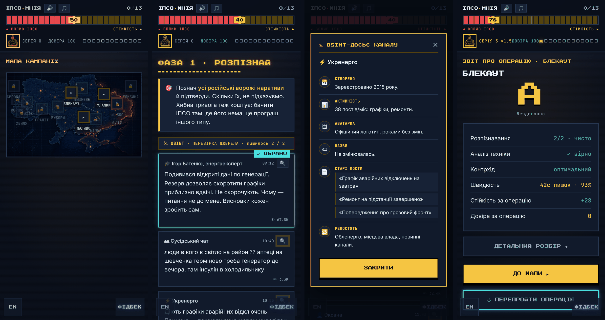

# Ipsomnia · Info-Resilience Trainer

[](.github/workflows/ci.yml)
[](CHANGELOG.md)
[](#quick-start)
[](#localisation)
[](LICENSE)

**Українська версія: [README.uk.md](README.uk.md)**

A browser game that trains people to recognise and counter hostile information
operations (IPSO). The player runs operations across a map of Ukraine: spots hostile
posts in a messenger-style feed, checks sources with OSINT, names the manipulation
technique, picks a counter-move against the clock and gets a full after-action report.

The methodology follows inoculation theory: a weakened, controlled dose of
manipulation builds resistance to the real thing.

**Play now:** <https://ipsomnia.com/>



## Features

- **13 operations** (12 + final boss) built on real patterns of hostile campaigns, each
  with a brief, a live feed, a technique quiz, a timed counter-move and a debrief.
- **OSINT dossiers.** Every post has a source profile (registration date, activity,
  name history, old posts, who reposts it). Facts only, no verdict: the player decides.
- **Living economy.** Resilience, trust, streak multipliers, information-vacuum timer,
  "loud silence" counter, vulnerability profile at the end of the campaign.
- **Roles as difficulty.** Press officer, staff comms officer, crisis manager: different
  time budgets, penalty multipliers and odds of wildcard events.
- **Built-in tutorial**, cutscenes with an Instructor and a boss, retro CRT terminal look.
- **Red Team mode.** Build your own operation in `creator.html` and share it as a link
  or QR code; the engine plays it unchanged.
- **Ukrainian and English** UI and content, switchable at any moment without losing progress.
- **Zero dependencies, zero build.** Works offline, on a phone or a laptop, from a double-click.

## Quick start

```bash
git clone <repo-url> ipsomnia
cd ipsomnia
python3 -m http.server 8000      # or: npm run serve
# open http://localhost:8000
```

Opening `index.html` directly from disk also works; a local server only guarantees
that fonts and sound load in every browser.

Developer tooling (optional, Node 18+):

```bash
npm install          # ESLint + Playwright for the smoke test
npm run lint         # syntax check, content linter, ESLint
npm test             # headless full-cycle playthrough
```

## How it is built

The one rule everything follows: **content is data, the engine is generic.**

```
content.js   data:  operations (SCENARIOS), roles, wildcards, map pins, dialogue · UK + EN
engine.js    logic: state, phases, timers, HUD, screens, pack mode
index.html   markup, styles, intro splash
```

Adding an operation means appending one object to `SCENARIOS_UK` and `SCENARIOS_EN`;
`engine.js` does not change. The full schema of an operation is documented at the top
of `content.js`, the engine's table of contents at the top of `engine.js`, and the
runtime flow, state and economy in [ARCHITECTURE.md](ARCHITECTURE.md).

## Repository layout

| Path | What it is |
|---|---|
| `index.html` | Entry point: markup, styles, intro splash |
| `engine.js` | Game engine |
| `content.js` | Content pack, Ukrainian and English |
| `design-tokens.css` | Palette, glow, CRT overlays |
| `creator.html` | Red Team mode: operation builder → `?pack=` link |
| `validate.js` | Content linter (`node validate.js`) |
| `test/smoke.js` | Headless playthrough used by CI |
| `assets/` | Art, fonts (`fonts/`), sound (`sfx/`) |
| `docs/` | Architecture notes, dev log, screenshots |
| `archive/` | First single-file demo and the CRT effects lab; not used by the game |

## Localisation

Both UI strings (`engine.js`, `UI` dictionary) and content (`content.js`, `*_UK` / `*_EN`
arrays) exist in Ukrainian and English. `validate.js` enforces structural and gameplay
parity between the two packs, so a translation cannot silently change the balance.

## Content rules

All actors in the scenarios are fictional. Real events are used only as situation
archetypes, never with invented facts presented as real, and never with real names of
private individuals. See [CONTRIBUTING.md](CONTRIBUTING.md) for the full rules and the
workflow for adding an operation.

## Deployment

Any static host. The repository root is the site root. `_redirects` holds the Netlify
redirect from `ipsomnia.netlify.app` to `ipsomnia.com`.

## Third-party components

- `qrcode.js`: QR Code Generator, © Kazuhiko Arase, MIT License.
- Fonts Inter, JetBrains Mono, Press Start 2P: SIL Open Font License 1.1.

## License

© Cultural Forces (ГО «Культурний Десант»). All rights reserved. See [LICENSE](LICENSE).
