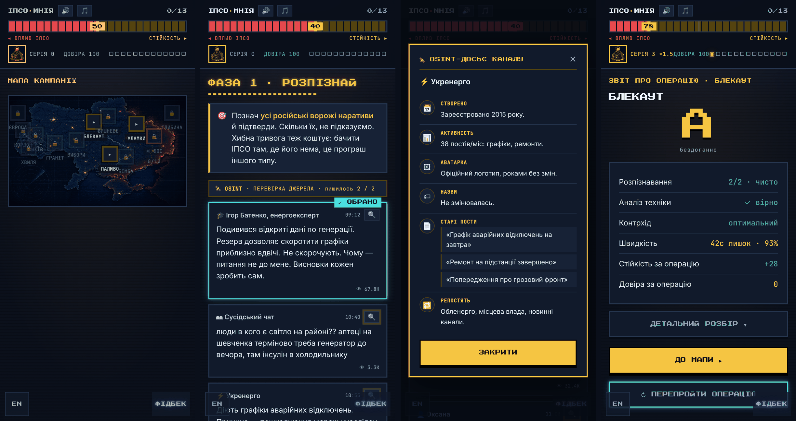

# Іпсомнія · Тренажер інфостійкості

[](.github/workflows/ci.yml)
[](CHANGELOG.md)
[](#швидкий-старт)
[](#локалізація)
[](LICENSE)

**English version: [README.md](README.md)**

Браузерна гра, що вчить розпізнавати ворожі інформаційно-психологічні операції (ІПСО)
і протидіяти їм. Гравець проходить операції на мапі України: знаходить ворожі пости у
стрічці, стилізованій під месенджер, перевіряє джерела через OSINT, називає техніку
маніпуляції, обирає контрхід на таймері й отримує повний розбір після операції.

Методологічна основа: inoculation theory. Ослаблена, контрольована доза маніпуляції
робить людину стійкішою до справжньої.

**Грати:** <https://ipsomnia.com/>



## Можливості

- **13 операцій** (12 + фінальний бос) на основі реальних патернів ворожих кампаній:
  бріфінг, жива стрічка, аналіз техніки, контрхід на таймері, дебриф.
- **OSINT-досьє.** У кожного поста є профіль джерела: дата реєстрації, активність, історія
  назв, старі пости, хто репостить. Лише факти, без вердикту: висновок робить гравець.
- **Жива економіка.** Стійкість, довіра, множники серії, таймер інфовакууму, лічильник
  «гучного мовчання», профіль вразливості на фіналі кампанії.
- **Ролі як складність.** Пресофіцер, комунікаційник штабу, кризовий менеджер: різний
  час на рішення, множники штрафів і ймовірність несподіваних подій.
- **Вбудований туторіал**, катсцени з Інструктором і босом, ретро-термінал у стилі CRT.
- **Режим «Червона команда».** Збери власну операцію в `creator.html` і поділись
  посиланням або QR-кодом; двигун грає її без змін.
- **Українська та англійська** мови інтерфейсу й контенту, перемикання будь-якої миті
  без втрати прогресу.
- **Без залежностей і без білду.** Працює офлайн, на телефоні й ноутбуці, з подвійного кліку.

## Швидкий старт

```bash
git clone <repo-url> ipsomnia
cd ipsomnia
python3 -m http.server 8000      # або: npm run serve
# відкрити http://localhost:8000
```

Відкрити `index.html` просто з диска теж можна; локальний сервер лише гарантує, що
шрифти і звук завантажаться в будь-якому браузері.

Інструменти розробника (необов'язково, Node 18+):

```bash
npm install          # ESLint + Playwright для smoke-тесту
npm run lint         # перевірка синтаксису, лінтер контенту, ESLint
npm test             # headless-прохід повного циклу гри
```

## Як це побудовано

Єдине правило, якому підпорядковане все: **контент є даними, двигун є універсальним.**

```
content.js   дані:   операції (SCENARIOS), ролі, wildcard, піни мапи, діалоги · UK + EN
engine.js    логіка: стан, фази, таймери, HUD, екрани, pack-режим
index.html   розмітка, стилі, інтро-заставка
```

Нова операція = один об'єкт у `SCENARIOS_UK` і `SCENARIOS_EN`; `engine.js` при цьому не
змінюється. Повна схема об'єкта операції описана в хедері `content.js`, зміст двигуна в
хедері `engine.js`, а потік гри, стан і економіка в [ARCHITECTURE.md](ARCHITECTURE.md).

## Структура репозиторію

| Шлях | Що це |
|---|---|
| `index.html` | Точка входу: розмітка, стилі, інтро-заставка |
| `engine.js` | Двигун гри |
| `content.js` | Контент-пак, українська та англійська |
| `design-tokens.css` | Палітра, свічення, CRT-оверлеї |
| `creator.html` | Режим «Червона команда»: конструктор операцій → посилання `?pack=` |
| `validate.js` | Лінтер контенту (`node validate.js`) |
| `test/smoke.js` | Headless-прохід гри для CI |
| `assets/` | Арт, шрифти (`fonts/`), звук (`sfx/`) |
| `docs/` | Архітектура, журнал розробки, скріншоти |
| `archive/` | Перша однофайлова демка і лабораторія CRT-ефектів; у грі не використовуються |

## Локалізація

І рядки інтерфейсу (`engine.js`, словник `UI`), і контент (`content.js`, масиви `*_UK` /
`*_EN`) існують українською та англійською. `validate.js` перевіряє структурний і
геймплейний паритет двох паків, тому переклад не може непомітно змінити баланс.

## Правила контенту

Усі суб'єкти в сценаріях фіктивні. Реальні події використовуються лише як типажі
ситуацій, без вигаданих фактів, поданих як реальні, і без реальних імен приватних осіб.
Повні правила й порядок додавання операції: [CONTRIBUTING.md](CONTRIBUTING.md).

## Деплой

Будь-який статичний хостинг. Корінь репозиторію і є корінь сайту. `_redirects` містить
редирект Netlify з `ipsomnia.netlify.app` на `ipsomnia.com`.

## Сторонні компоненти

- `qrcode.js`: QR Code Generator, © Kazuhiko Arase, ліцензія MIT.
- Шрифти Inter, JetBrains Mono, Press Start 2P: SIL Open Font License 1.1.

## Ліцензія

© Культурні сили (ГО «Культурний Десант»). Усі права захищені. Див. [LICENSE](LICENSE).
